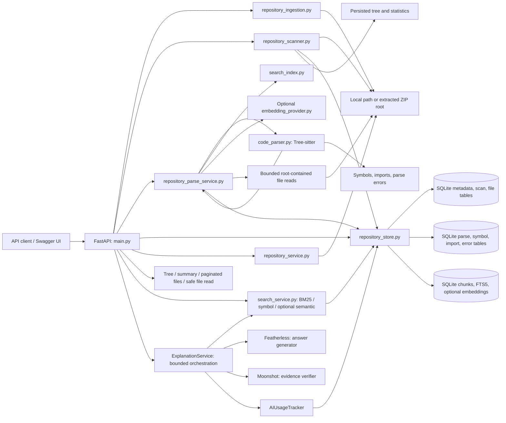

# Architecture

## Current architecture

Repository Explorer currently has a modular FastAPI backend, SQLite persistence for repository metadata and scan snapshots, Tree-sitter parsing with structural symbol/import indexes, repository-scoped hybrid search, and a bounded evidence-grounded explanation endpoint. It has no frontend or autonomous agent loop.

## Project structure

- `main.py`: FastAPI app, schemas, URL validation, ingestion/scanning routes, file listing and content route validation.
- `repository_ingestion.py`: Phase 1 local path validation and safe bounded ZIP extraction.
- `repository_service.py`: Git clone and a compatibility wrapper for the common scanner.
- `repository_scanner.py`: filesystem walk, filtering/classification, language detection, scan cache workflow, and tree construction.
- `code_parser.py`: language grammar registry, Tree-sitter traversal, language-specific symbol/import extraction, and source-location normalization.
- `repository_parse_service.py`: scan-state checks, safe bounded source reads, content-hash caching, parse limits, result/error handling, and parse summaries.
- `repository_store.py`: SQLite schema and operations for repository/scan/file metadata and parser status, symbols, imports, and errors.
- `search_index.py`: deterministic non-overlapping source chunks with exact inclusive line ranges and practical symbol boundaries.
- `search_service.py`: repository-scoped retrieval, component normalization, deduplication, and weighted ranking.
- `ai_explanation.py`: `ExplanationService` bounds evidence, coordinates Featherless claim generation, at most one validated retrieval-tool call, independent Moonshot verification, deterministic schema/reference validation, response construction, and best-effort `AIUsageTracker` records.
- `embedding_provider.py`: optional provider protocol and explicitly configured OpenAI-compatible HTTP adapter; no provider is enabled by default.
- `tests/`: Phase 1/2 regression tests, Phase 3 parser/API tests, and Phase 4 retrieval/index-consistency tests.
- `requirements.txt`: Python dependencies.
- `README.md`: startup, API, and scanning configuration.
- `SPEC.md`, `AGENTS.md`, `FEATURES.md`, `IMPLEMENTATION_REPORT.md`: specification and engineering documentation.

Repository metadata, scan statistics, and file entries live in `repository_metadata.sqlite3` under `REPOSITORY_STORAGE`. ZIP uploads and Git clones are stored in unique ID-named directories. Local paths are registered in place.

## Phase 2 scanning flow

1. The client registers a local directory or ZIP using Phase 1. GitHub cloning retains its immediate scan behavior.
2. For local/ZIP inputs, `POST /repositories/{id}/scan` resolves the repository ID through SQLite and verifies its ingestion status and root path.
3. `repository_scanner.py` walks entries with `os.scandir`, sorting each directory deterministically. It stores relative POSIX paths, sizes, extensions, language, UTC modification time, hidden status, inclusion status, category flags, and an exclusion reason.
4. The scanner never follows symlinks or Windows junctions. It marks them as excluded entries. It detects binary content using known binary extensions or at most an 8 KiB sample for eligible files.
5. Excluded directories are represented in the tree and traversed for file/folder totals and explanatory metadata; their contents inherit the directory exclusion reason and are not content-sniffed.
6. One SQLite transaction replaces the repository's prior file snapshot and writes summary statistics, language counts, extension counts, and completion time. A primary key on `(repository_id, relative_path)` prevents duplicate records.
7. Repeated scan requests return the saved snapshot unless `force=true`. A failed forced scan leaves the prior completed snapshot intact.
8. Tree, summary, paginated file metadata, and content endpoints read the persisted scan. File content is read only after validating the relative path, confirming the scanned file row, rejecting symlink/junction components, resolving under the registered root, and enforcing a read-size limit.

## Phase 3 parsing flow

1. A client calls `POST /repositories/{id}/parse` after a completed Phase 2 scan. Parsing is not automatically triggered by clone or scan.
2. `repository_parse_service.py` verifies the repository is ready and its scan is complete, then atomically claims a parse run. It skips excluded, binary, oversized, and over-limit entries without opening them. Tree-sitter is skipped for unsupported grammars; Phase 4 may still safely read included text files to make raw lexical chunks.
3. For eligible files, the parser validates the stored relative path, rejects symlink/junction components, resolves the path under the registered root, opens a regular file without following the final link, and reads at most the configured parse-size limit.
4. UTF-8 content is hashed with SHA-256. A matching prior hash and language reuses the saved symbols/imports; changed content (or `force=true`) is parsed.
5. `code_parser.py` uses the grammar selected by Phase 2's language and extension metadata. It traverses syntax trees to extract class-like declarations, functions/methods, parameters, imports, source snippets, and source positions. Tree-sitter error nodes produce a partial result plus a recorded syntax error.
6. Each file's current parser state, symbols, imports, errors, and search index rows are replaced transactionally. A completed run removes per-file rows for paths no longer present in the latest scan and stores summary counts. A changed Phase 2 scan invalidates parse and search reads until parsing is run again.
7. Symbol, import, and parsing-summary routes return persisted results. Imports are source-level statements and do not establish runtime dependencies.

## Phase 4 search flow

1. Search requires a successful parse for the current scan timestamp. A forced rescan invalidates search until parsing completes again.
2. Parsing splits included UTF-8 text into deterministic, non-overlapping chunks at symbol boundaries where practical, then at an 80-line target (120-line maximum). Chunk text is sliced from the exact source lines, and ranges are one-based and inclusive.
3. Parser-backed files contribute indexed symbol names and types. Included text files without a configured Tree-sitter grammar receive raw lexical chunks while retaining their `skipped` parser status. Excluded, binary, oversized, unreadable, and over-limit files are not indexed.
4. `search_documents` belongs to a `search_index_files` row, which belongs to `parsed_files`. Replacing or deleting parse state cascades through chunks and embeddings; FTS5 triggers keep the full-text index synchronized. A completed parse also removes file records absent from the latest scan.
5. Hash-matched files keep their current chunks without Tree-sitter reparsing. Missing Phase 4 chunks (including an older Phase 3 database) or changed embedding configuration trigger chunk refresh from the already safely-read source.
6. Every search query is scoped to one repository, a completed current parse/scan pair, included scanner entries, and eligible parse states. Before ranking results, it safely rereads and SHA-256 validates each distinct candidate file once; any changed, missing, newly excluded, or unverifiable candidate fails the entire request with `409`.
7. BM25, cosine similarity, and symbol relevance are independently normalized to `[0, 1]`. Hybrid ranking starts with weights `0.4/0.4/0.2`; unavailable methods are omitted and remaining weights renormalized. Without semantic search the effective weights are lexical `2/3` and symbol `1/3`. Methods contribute to the same document before same-path/line ranges are deduplicated.

Parent-child relationships use `repository_symbols.parent_symbol_id` (self-reference). Nested declarations point to the nearest enclosing class, function, or method. Go receiver methods and Rust `impl` methods link to a same-file type declaration when one is present. Each `file_path` is a repository-relative POSIX path. Lines are one-based and end lines inclusive; columns are one-based character columns with an exclusive end column. Snippets are capped at 32,768 characters and indicate truncation.

## SQLite schema

- `repositories`: Phase 1 ID, name, root path, input type, creation time, ingestion status, and safe error text.
- `repository_scans`: scan status, completion timestamp, statistics JSON, language and extension distributions, and scan error text.
- `repository_files`: one unique row per repository-relative directory, regular file, or symlink; stores type, size, extension, language, modification time, hidden/included flags, classification flags, and exclusion reason.
- `repository_parses`: last parse run status, run ID, scan snapshot timestamp, timing, counts, and operation-level error.
- `parsed_files`: per-path content hash, language, parsing status/reason, last-seen parse run, and parse timestamp. This is the parent for per-file parse records.
- `repository_symbols`: symbol ID, repository-relative file path, name/qualified name, type, language, parent symbol, one-based locations, parameters JSON, source snippet, truncation flag, and byte offsets. Foreign keys link to the repository and `parsed_files`; a self-reference links parent symbols.
- `repository_imports`: source-level imported module/symbol/alias/type, path, language, snippet, and one-based source range. Foreign keys link to the repository and `parsed_files`.
- `repository_parse_errors`: parse or file-read errors with relative path, language, reason, safe message, optional line, and timestamp. Foreign keys link to the repository and `parsed_files`.
- `ai_usage`: additive metadata-only provider-call usage records keyed uniquely by `(request_id, call_number)`, including repository, role, provider/model, token counts and actual/unavailable usage, optional cost/pricing basis, duration, status, and timestamp. Prompts, excerpts, and credentials are never stored.
- `search_index_files`: per-file search content hash, chunk count, provider/model identifiers, and embedding count. Child of `parsed_files`.
- `search_documents`: source chunks with repository/path/language, exact inclusive range, snippet, and available symbol metadata. Child of `search_index_files`.
- `search_documents_fts`: SQLite FTS5 external-content index over file path, symbol names, language, and source text; insert/delete triggers keep it synchronized.
- `search_embeddings`: optional vectors keyed to a search document and provider/model. It contains rows only when a configured provider successfully returns embeddings.

There is no migration framework in the project. Tables and indexes are created with `CREATE TABLE/INDEX IF NOT EXISTS`.

## API architecture

| Method | Route | Purpose |
|---|---|---|
| `POST` | `/repositories/local` | Register a non-empty local directory. |
| `POST` | `/repositories/upload` | Validate and safely extract a ZIP archive. |
| `GET` | `/repositories` | List persisted repository metadata. |
| `GET` | `/repositories/{repository_id}` | Retrieve ingestion status and location metadata. |
| `POST` | `/repositories/{repository_id}/scan` | Scan once, return cached scan, or force refresh. |
| `POST` | `/repositories/{repository_id}/parse` | Parse eligible files from the completed scan; `force=true` reparses unchanged files. |
| `GET` | `/repositories/{repository_id}/symbols` | Paginated/filterable symbols (`name`, type, language, exact path). |
| `GET` | `/repositories/{repository_id}/symbols/{symbol_id}` | Retrieve a symbol and its source evidence. |
| `POST` | `/repositories/{repository_id}/search` | Search with `hybrid`, `lexical`, `symbol`, or optional `semantic` retrieval and language/path/type filters. |
| `POST` | `/repositories/{repository_id}/ask` | Retrieve bounded search evidence and generate a cited explanation when Featherless is configured. |
| `GET` | `/repositories/{repository_id}/imports` | Paginated/filterable source import records. |
| `GET` | `/repositories/{repository_id}/parsing-summary` | Parse run status, counts, errors, and skipped reasons. |
| `GET` | `/repositories/{repository_id}/tree` | Return the persisted hierarchical tree. |
| `GET` | `/repositories/{repository_id}/summary` | Return file, directory, size, language, and exclusion statistics. |
| `GET` | `/repositories/{repository_id}/files` | Paginate file/symlink metadata with optional path and exclusion filters. |
| `GET` | `/repositories/{repository_id}/file?path=...` | Return bounded UTF-8 content for a scanned file. |
| `GET` | `/repositories/{repository_id}/files/{path}` | Backward-compatible content alias, hidden from generated OpenAPI docs. |
| `POST` | `/github` | Validate and normalize a GitHub URL. |
| `POST` | `/repositories/clone` | Clone and scan a public GitHub repository immediately. |

## Configuration

- `REPOSITORY_STORAGE`: filesystem location for ZIP extraction, Git clones, and SQLite.
- `REPOSITORY_EXCLUDED_DIRECTORIES`: comma-separated directory-name exclusions.
- `REPOSITORY_GENERATED_PATTERNS`: comma-separated filename/path globs.
- `REPOSITORY_MAX_FILE_SIZE_BYTES`: per-file inclusion limit, default 1 MiB.
- `REPOSITORY_MAX_SCAN_FILES`: maximum file-like entries, default 10,000.
- `REPOSITORY_MAX_SCAN_ENTRIES`: maximum total metadata entries, default 50,000.
- `REPOSITORY_MAX_FILE_READ_BYTES`: file content response limit, default 1 MiB.
- `REPOSITORY_MAX_PARSE_FILE_BYTES`: maximum bytes read for one parse file, default follows the Phase 2 file-size limit (1 MiB).
- `REPOSITORY_MAX_PARSE_FILES`: maximum eligible files considered per parse run, default 10,000.
- `REPOSITORY_MAX_PARSE_TOTAL_BYTES`: total source bytes accepted by a parse run, default 250 MiB.
- `SEARCH_EMBEDDING_ENDPOINT`: optional explicit HTTP(S) embeddings endpoint; the included adapter expects an OpenAI-compatible request/response format.
- `SEARCH_EMBEDDING_MODEL`: model identifier required with the endpoint.
- `SEARCH_EMBEDDING_API_KEY`: optional bearer token; local values may live in the ignored root `.env.secret`.
- `FEATHERLESS_API_KEY`, `FEATHERLESS_MODEL`: backend-only Answer Generator configuration.
- `MOONSHOT_API_KEY`, `MOONSHOT_MODEL`: backend-only Evidence Verifier configuration. The model identifier is operator-configured; no identifier is assumed.
- `FEATHERLESS_TIMEOUT_SECONDS`, `MOONSHOT_TIMEOUT_SECONDS`: independent provider request timeouts, each defaulting to 45 seconds and validated in the range `(0, 600]`.
- `FEATHERLESS_INPUT_PRICE_PER_MILLION`, `FEATHERLESS_OUTPUT_PRICE_PER_MILLION`, `MOONSHOT_INPUT_PRICE_PER_MILLION`, `MOONSHOT_OUTPUT_PRICE_PER_MILLION`: optional operator-maintained prices. Costs are null unless both token rates for that provider and provider-reported token usage are available. `FEATHERLESS_PRICING_VERSION` and `MOONSHOT_PRICING_VERSION` label the configured pricing basis.

ZIP upload/extraction configuration is documented in `README.md`.

## Current limitations

- Language detection is extension based. Binary detection uses a fixed extension set plus a bounded byte sample.
- Scanning is synchronous and limited by configurable entry/file counts.
- A cached scan is not automatically invalidated when local files or environment filter settings change; clients must request `force=true`.
- File contents are limited to UTF-8 text and the configured response-size cap.
- No authentication/authorization is present; use only in a trusted local environment.
- Tree-sitter supports Python, JavaScript, TypeScript/TSX, Java, C, C++, C#, Go, Rust, PHP, and Ruby. HTML, CSS, SQL, and other Phase 2 languages are recorded as skipped because no structural extractor grammar is configured.
- Parsing is synchronous. The current pinned Python binding does not expose an assignable parser timeout, so file-count and byte limits bound work; very complex files near the size limit may still take longer than usual.
- Parser snippets are truncated at 32,768 characters. Unsupported grammar constructs may not yield symbols even when their file language has a configured grammar.
- Search candidate generation is capped at 500 rows per method. Semantic similarity currently scans stored vectors in Python; large vector collections may need a dedicated vector index.
- Semantic retrieval sends indexed source text only to the explicitly configured endpoint. Lexical and symbol search need no external service or credentials.
- Search validates only distinct files represented in its bounded retrieval candidates, not the entire repository. This detects stale candidate snippets without hashing every file on every request. A detected change or unverifiable file returns `409` and requires a forced scan followed by parsing. New files are not discovered or searchable until that explicit refresh. Validation is not an atomic filesystem snapshot; metadata checks detect common writes during reads, but concurrent filesystem mutation immediately after validation remains possible.
- Phase 5 sends only selected bounded excerpts to two separate providers: Featherless generates structured claims and Moonshot independently assesses each claim. The service requires exactly one valid assessment per claim and labels each status `model_assessed_*`; only supported claims are stated as facts. Assessment is fallible and does not guarantee factual correctness. All returned locators/snippets are sourced from validated Phase 4 records. Tool-calling support varies by generator model; at most one validated retrieval call is supported, with no autonomous investigation loop or conversation history. Usage writes are best effort and do not invalidate a successful explanation.
